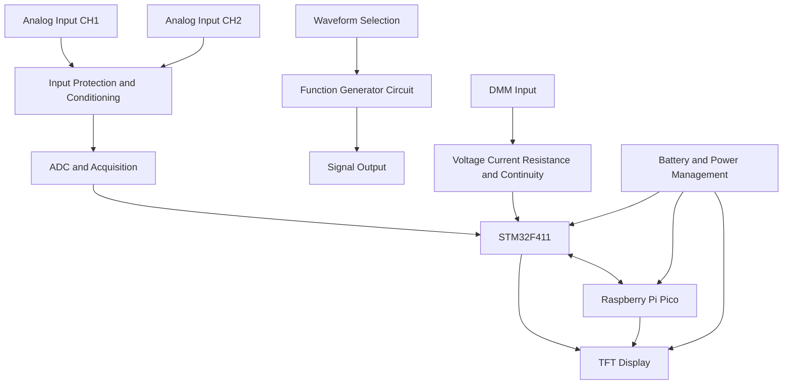

# ⚡ Portable Multi-Utility Test Instrument

### A pocket-sized electronics lab. Three instruments. One portable device.

<em>Oscilloscope · Function Generator · Digital Multimeter</em>

 

  

---

### ▰ SYSTEM OVERVIEW ▰

---

## 🧪 Overview

The **Portable Multi-Utility Test Instrument** is a compact, battery-powered electronics test platform designed to combine three essential laboratory instruments into one handheld device.

The project integrates a dual-channel oscilloscope, a waveform function generator, and a digital multimeter into a menu-driven interface powered by an **STM32F411 and Raspberry Pi Pico**.

The goal is to make everyday electronics testing more accessible and portable without sacrificing the measurement features that matter during circuit development and debugging.

---

## 🧪 Overview

The **Portable Multi-Utility Test Instrument** is a compact, battery-powered electronics test platform designed to combine three essential laboratory instruments into one handheld device.

The project integrates a dual-channel oscilloscope, a waveform function generator, and a digital multimeter into a menu-driven interface powered by an **STM32F411 and Raspberry Pi Pico**.

The goal is to make everyday electronics testing more accessible and portable without sacrificing the measurement features that matter during circuit development and debugging.

## ✨ Key Features

### 📈 01 · Dual-Channel Oscilloscope

- Two-channel analog signal input
- Target input signal bandwidth of up to **10 MHz**
- Grid-based waveform display on a TFT screen
- Voltage and time measurement capabilities
- Waveform scaling and measurement cursors
- Analog input conditioning and protection

### 〰️ 02 · Function Generator

Generate standard test waveforms for circuit testing and experimentation.

- Sine wave
- Square wave
- Triangular wave
- Target output frequency of up to **10 MHz**
- Frequency and waveform selection through the menu
- Dedicated signal-generation circuitry

### 🔬 03 · Digital Multimeter

A built-in measurement mode for everyday electronics work.

- DC voltage measurement
- Current measurement
- Resistance measurement
- Continuity testing with audible indication
- Dedicated measurement interface

### 🖥️ 04 · TFT User Interface

- TFT display with a grid-style oscilloscope view
- Menu-driven instrument selection
- Separate interfaces for scope, generator and DMM modes
- On-screen measurement values and status indicators
- Compact interface designed for handheld operation

### 🔋 05 · Portable Power System

- Battery-powered operation
- Compact, carryable enclosure
- Integrated power management
- Designed for electronics labs, workshops and field debugging

---

## 🧠 System Architecture

The instrument combines two microcontroller platforms, with responsibilities divided according to the final hardware architecture.

*Conceptual architecture. The final allocation of acquisition, display, measurement and waveform-generation tasks will depend on the implemented hardware.*

| Subsystem | Platform / Circuit | Purpose |
|---|---|---|
| Main controller | STM32F411 | Embedded control and measurement processing |
| Secondary controller | Raspberry Pi Pico | Supporting control and peripheral tasks |
| Signal acquisition | Analog front end and ADC | Capture incoming waveforms |
| Signal generation | Waveform-generation circuitry | Generate test signals |
| Measurement section | Analog measurement circuits | Voltage, current, resistance and continuity |
| User interface | TFT display | Waveforms, readings and menus |
| Power system | Rechargeable battery system | Portable operation |

---

## 📊 Target Specifications

| Parameter | Design Target |
|---|---|
| Oscilloscope channels | 2 |
| Oscilloscope input bandwidth | Up to 10 MHz |
| Display | TFT, grid-based waveform view |
| Function generator waveforms | Sine, square and triangular |
| Function generator frequency | Up to 10 MHz |
| DMM functions | Voltage, current, resistance |
| Continuity testing | Yes |
| Main controller | STM32F411 |
| Secondary controller | Raspberry Pi Pico |
| User interface | Menu-driven |
| Power source | Battery |
| Form factor | Compact and portable |

*These are project targets, not verified test results. Achievable bandwidth, sample rate, waveform quality, measurement accuracy, output amplitude and battery life will be documented after hardware validation.*

---

## 🛠️ Hardware Design Focus

- **Analog front end:** input attenuation, signal conditioning, coupling and overvoltage protection.
- **Data acquisition:** ADC selection, sampling strategy, timing and waveform reconstruction.
- **Waveform generation:** appropriate DAC or DDS architecture and output-stage design.
- **DMM circuitry:** measurement ranges, current-sense elements, resistance measurement and continuity detection.
- **Embedded firmware:** peripheral configuration, measurement processing, display updates and menu navigation.
- **Power design:** battery management, regulated supply rails and low-noise analog power.
- **PCB design:** grounding, signal integrity, analog/digital separation and EMI considerations.

## 💻 Technology Stack

  
  
  
  
  

**Core areas:** Embedded systems · Analog circuit design · ADC acquisition · Signal generation · Measurement systems · PCB design · Hardware debugging

---

## 🚧 Development Roadmap

- [ ] Finalize system architecture and controller responsibilities
- [ ] Design and validate the protected dual-channel analog front end
- [ ] Implement waveform acquisition and grid-based display
- [ ] Develop voltage and time measurement functions
- [ ] Integrate sine, square and triangular waveform generation
- [ ] Implement DMM voltage, current and resistance modes
- [ ] Add continuity detection
- [ ] Build the menu-driven TFT interface
- [ ] Integrate battery power management
- [ ] Validate bandwidth, sampling performance and measurement accuracy
- [ ] Design the compact enclosure and perform end-to-end testing

## 🎯 Project Goal

To develop an affordable, portable electronics instrument that brings essential circuit measurement and signal-generation capabilities into a single compact device.

The project explores the intersection of **embedded firmware, analog electronics, instrumentation and practical hardware engineering**.

---

  <strong>Designed to measure. Built to debug. Made to carry.</strong>
   
  Built from the circuit level up.

